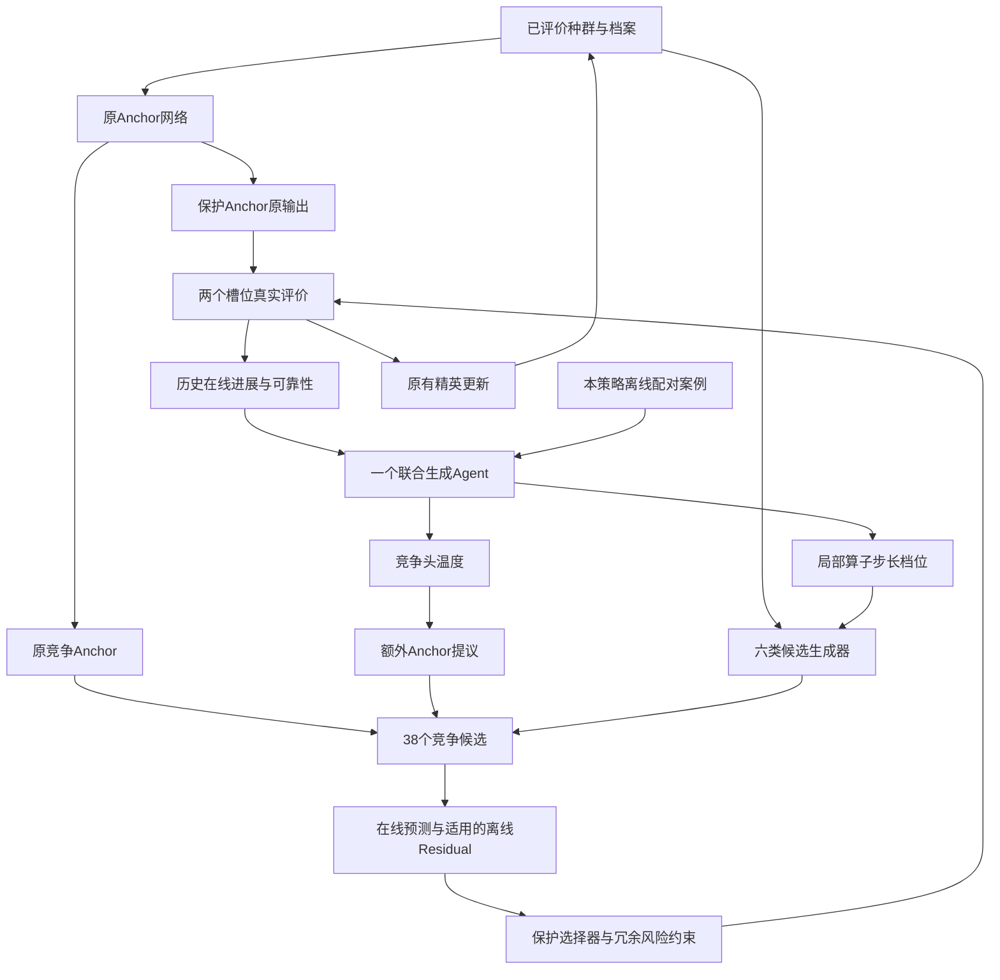

# R07：一个 Agent 协调 Anchor 与局部候选生成

当前状态：代码实现，未执行。按用户本轮明确要求，不运行测试、策略筛选、案例采集、API 或全量实验。此目录不是已完成实验结果。

## 单一方案及控制档位

一个 `JointGenerationAgent` 在原融合有效阶段第5、15轮读取历史在线信息与当前策略离线案例，选择一个联合配置，每次持续5轮。配置是同一控制器的动作，不是待筛选的实现方案。所有档位固定保留，没有按验证收益删除动作。

保护 Anchor 保持原网络调用及原输出。竞争侧保留原 Anchor，增加一个温度调整后的竞争提议；温度仅改变第二输出头的特征权重，不修改冻结权重，不代表空间距离必然增大或减小。温度为1时额外槽使用独立本地随机流产生的原 trust-region 提议，用作等候选数对照。

局部生成保留 trust-region 和 coordinate-pattern 的中心与随机方向，仅调整各自最后3个候选的修复前位移；每类前3个候选和其他生成器保持原规则。先缩放、再边界修复。

| 配置 | Anchor温度 | 局部步长倍率 | 选择 |
|---|---:|---:|---|
| release | 1 | 1 | 原选择 |
| matched38 | 1 | 1 | 协调选择，额外原生局部候选 |
| anchor_sharp | 0.8 | 1 | 协调选择 |
| anchor_soft | 1.25 | 1 | 协调选择 |
| local_fine | 1 | 0.5 | 协调选择 |
| local_wide | 1 | 1.5 | 协调选择 |
| joint_sharp_wide | 0.8 | 1.5 | 协调选择 |
| joint_soft_fine | 1.25 | 0.5 | 协调选择 |

## 协调竞争和反馈

Agent 只决定配置，程序数值选择最终候选。评分从现有在线采集分数出发，使用按来源及生成档位分别记录的历史预测误差、Residual排序表现，以及相对保护点的重复惩罚。仍以原竞争Anchor为接受参照，调用原保护规则，保留结构性锁。

对于修改步长的候选和温度调整后的Anchor，暂不将旧Residual分数用于评分或接受。原始Residual预测仍记录，以便后续检查分布偏移；不把它解释成校准概率。适配选择保留Residual评分但不使用Residual否决门，原始 `release` 保留原选择结果。

真正的额外即时收益使用 `max(0,min(previous_best,protected_value)-competing_value)/pre_action_scale`。同时记录有符号的相对旧最优差值、预测误差、合并精英更新后的留存标志。五轮进展明确标记为包含Anchor和其他点贡献，不能当作因果收益。

预测的额外改善仅作为本地日志诊断，采用保护点预测与历史最优的较小值作为参照；它不是联合分布下的期望改善。评分系数为固定启发式，没有经过本轮验证，也不宣称统计置信保证。

所有API输入在生成前形成，只含过去已评价信息、状态摘要及训练案例。当前候选坐标、当前真实目标和离线诊断的候选真值不会发送给运行中的Agent。默认继承WorldCodes接口和DeepSeek配置，密钥继续由既有安全脚本读取；源代码不保存密钥。

## 原有流程边界

- 仍使用原融合有效阶段；早段Anchor主干、CEC结构锁和不足两个槽位的处理维持原约束。
- 保护Anchor的规则不变，但种群变化会间接改变未来Anchor坐标。
- 38竞争候选比R06多一个，增加原生额外候选对照；真实评价仍为每轨迹300次含初始100。
- `changed_points` 仅比较当前生成池上新旧选择结果，不等于相对原版整条轨迹的坐标差异。另记录生成档位启用和实际选中调整候选的次数。
- 局部候选索引保持原六类×六个布局；新增候选位于末尾，不改动原神经网络权重。
- 额外随机生成和Anchor候选计算包在独立随机状态上下文中，不推进原求解器随机流。

## 离线案例与执行入口

这些入口只是实现，本轮没有执行。

1. `scripts/collect_r07.py collect`：36生成函数×4种子，从第5轮原状态和第15轮已干预状态分别采集同前缀的联合动作分支；每个动作执行5轮，记录5/10轮配对收益。
2. `scripts/collect_r07.py memory`：构建仅含29训练函数的案例库，另外保留7函数数据，不做性能筛选。旧R06案例不会冒充新动作标签。
3. `scripts/experiment_r07_full.py run`：六个对照臂，各35函数×100轨迹，恢复原版配对初始种群和随机流；只有`llm_live`调用API，最多600次。
4. `scripts/report_r07.py`：生成逐函数均值/总体标准差、逐轨迹比较、API统计和原始结果压缩包。缺少完成记录时拒绝生成完整报告。

六个对照臂为原版等价、等38候选、仅Anchor控制、仅局部控制、同信息确定性联合控制、真实LLM联合控制。单侧和确定性对照是结果归因用途，不参与功能筛选。

离线候选池真值诊断在搜索完成后单独评价、单独计入费用，只用于分析候选质量及选择缺口。随机函数上的单次诊断是采样快照，不构成确定性最优候选保证。

## 未执行事项

未运行任何测试或实验，未调用API，未构建新案例库，未产生新收益结论。运行期预算、维度、前缀一致性、完整结果等检查是代码中的保护条件，并不表示这些检查已经通过。
